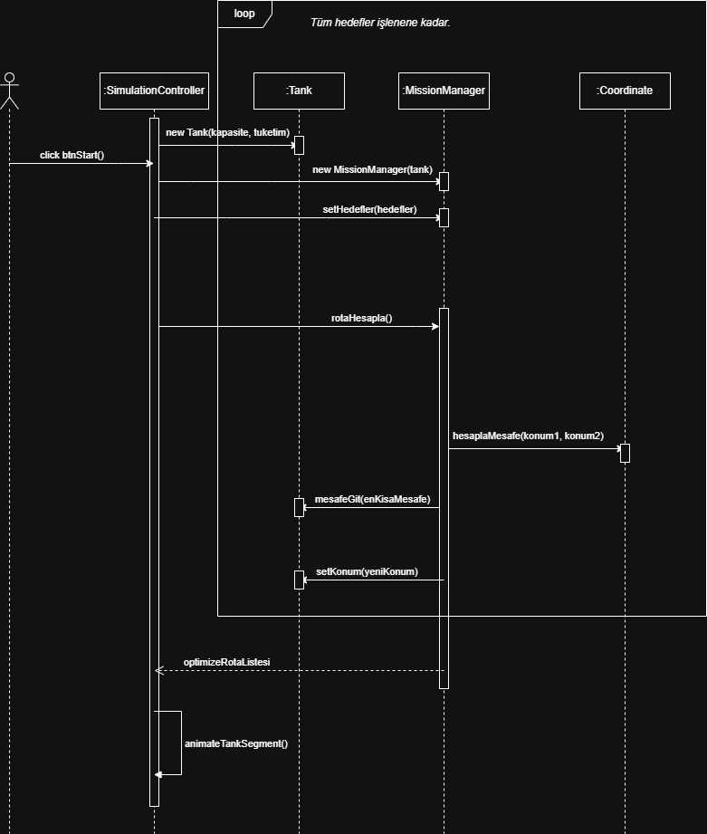

# Tank Görev Simülatörü

## Sistem Mimarisi (Use Case Diagram)

## Sistem Mimarisi (UML Sınıf Diyagramı - V2)

Projenin teknik altyapısı; sürdürülebilirlik, modülerlik ve savunma sanayii standartlarına uygun olarak tasarlanmıştır. Sistem; loglama mekanizması, durum yönetimi ve merkezi görev yöneticisi ile desteklenmektedir.

### Kullanılan Teknolojiler ve Altyapı

* **Loglama Mimarisi (SLF4J & Logback):**
  Sistemde telemetri verilerinin ve hata kayıtlarının tutulması için modern loglama standartları benimsenmiştir.
    * **Neden SLF4J (Arayüz)?** Kodun doğrudan spesifik bir loglama kütüphanesine (örneğin Log4j2 veya java.util.logging) sıkı sıkıya bağlanmasını (tight-coupling) önlemek için **Simple Logging Facade for Java (SLF4J)** kullanılmıştır. Bu mimari karar sayesinde, ileride kurumsal standartlar değiştiğinde kod mimarisinde hiçbir değişikliğe gitmeden sadece yapılandırma (pom.xml) üzerinden loglama motoru değiştirilebilir.
    * **Neden Logback (Motor)?** SLF4J'nin yerel (native) uygulaması olduğu için araya ek bir adaptör katmanı girmez. Bu durum, tankın hareket halindeyken ürettiği yoğun telemetri verilerinin gecikmesiz (yüksek performanslı) bir şekilde konsola ve log dosyalarına yazılmasını sağlar.
## ⚙️ Kurulum ve Çalıştırma
Projeyi kendi ortamınızda ayağa kaldırmak için aşağıdaki adımları izleyebilirsiniz:
1. Projeyi bilgisayarınıza klonlayın: `git clone https://github.com/fmervekilicarslan/tank-gorev-simulasyonu.git`
2. IDE'niz (IntelliJ IDEA vb.) üzerinden Maven bağımlılıklarını yükleyin (`pom.xml` dosyasını güncelleyerek).
3. **ÖNEMLİ:** Uygulamayı başlatmak için `AppLauncher` veya `Main` sınıflarını DEĞİL, JavaFX runtime yapılandırmasını güvenli bir şekilde başlatan `src/main/java/org/example/StartUI.java` sınıfını çalıştırın.

## 🧠 Rota Optimizasyon Algoritması (Hibrit TSP Çözümü)
Simülatör, tankın hedefleri dolaşması gereken rotayı belirlerken **Gezgin Satıcı Problemi (Traveling Salesperson Problem)** kuramından yararlanır. Performans ve doğruluk dengesini sağlamak amacıyla dinamik (hibrit) bir algoritma mimarisi kurgulanmıştır:

**1. Kesin Çözüm (Brute Force / Kaba Kuvvet) - Hedef Sayısı ≤ 10:**
Hedef sayısı 10 ve altında olduğunda, sistem tüm olası permütasyonları (O(N!)) hesaplayarak matematiksel olarak %100 kusursuz en kısa rotayı bulur.

**2. Sezgisel Çözüm (Nearest Neighbor) - Hedef Sayısı > 10:**
Hedef sayısı 10'u aştığında faktöriyel hesaplaması UI (arayüz) donmalarına yol açabileceği için sistem otomatik olarak En Yakın Komşu algoritmasına geçer:
* Tankın bulunduğu konumdan başlanarak henüz ziyaret edilmemiş hedefler taranır.
* Öklid (Euclidean) mesafe formülü `d = √((x2 - x1)² + (y2 - y1)²)` ile en yakın hedef seçilir ve tank o hedefe yönlendirilir.
* Bu işlem tüm hedefler bitene kadar döngüsel olarak tekrarlanır ve nihayetinde tank üsse (HQ) geri döner.

### 4. Hafta - Görev Başlatma ve Algoritma Akışı (Sequence Diagram)
Kullanıcının simülasyonu başlatmasıyla birlikte; UI katmanından Business Logic katmanına giden veri akışı, hibrit TSP algoritmasının tetiklenmesi ve testlerin çalışma sırası aşağıdaki UML Ardışık Düzen (Sequence) diyagramında modellenmiştir:

