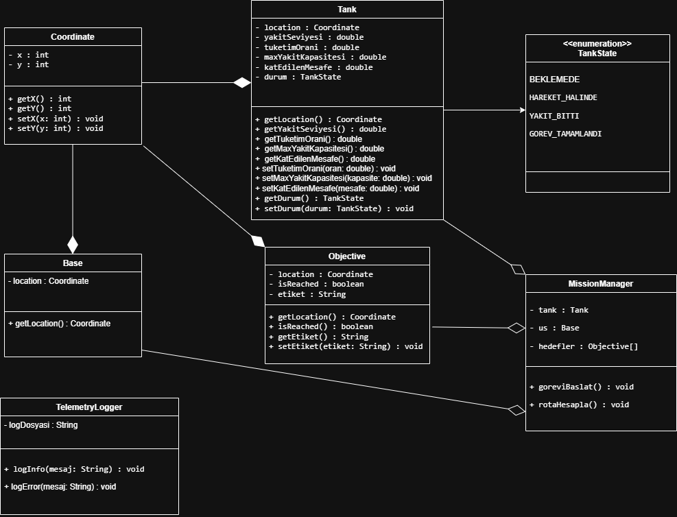

# Tank Görev Simülatörü

## Sistem Mimarisi (Use Case Diagram)

## Sistem Mimarisi (UML Sınıf Diyagramı - V2)

Projenin teknik altyapısı; sürdürülebilirlik, modülerlik ve savunma sanayii standartlarına uygun olarak tasarlanmıştır. Sistem; loglama mekanizması, durum yönetimi ve merkezi görev yöneticisi ile desteklenmektedir.

